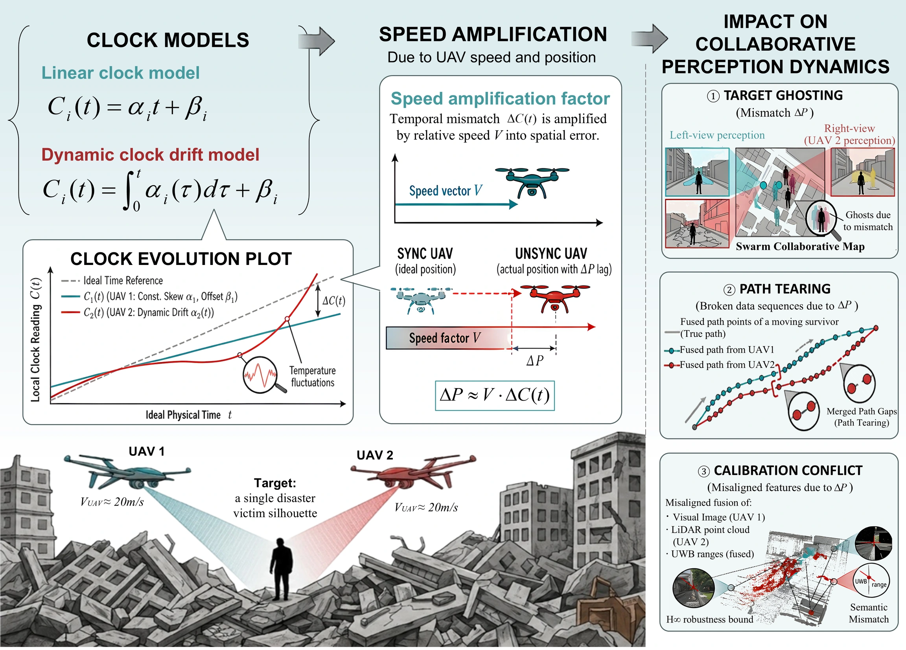
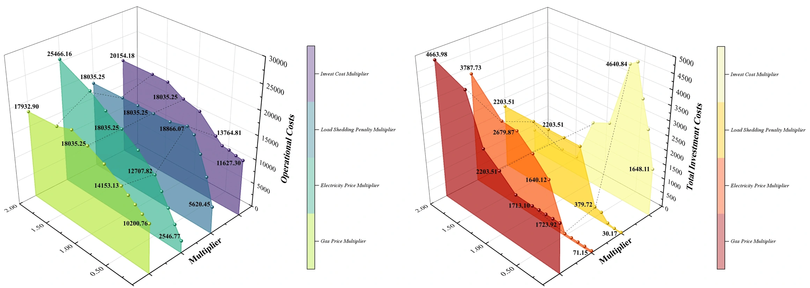

# HKU Research Visualization Portfolio

Selected work from my MSc studies at The University of Hong Kong. These two assignments show how I turn technical literature into scientific diagrams and simulation results into figures that support comparisons.

## Distributed Systems / 分布式系统

**ELEC7083 · Co-authored literature review** · Course instructor [Prof. Edith C. H. Ngai](https://ece.hku.hk/people/echngai/)

*Spatiotemporal Alignment Technology for Multi-UAV Collaborative Search and Rescue: From Passive Compensation to Active Planning*

Our review connects clock synchronization, asynchronous state recovery and spatial alignment in multi-drone search and rescue. It traces how the literature moves from compensating for timing and position errors to planning trajectories that help prevent them. I contributed to the literature review, manuscript drafting and scientific figures.

**[Read the full literature review (PDF)](reports/elec7083-distributed-systems-literature-review.pdf)**

### How clock drift affects collaborative perception

The schematic follows a timing mismatch from the clock model to a position error that grows with relative speed. Three scenarios connect that mechanism to practical failure modes in a shared map.

*Literature review, Fig. 1, p. 3.*

## Energy Internet / 能源网络

**ELEC7011 · Individual experiment report** · Course instructor [Prof. Yi Wang](https://ece.hku.hk/people/yiwang/)

I ran the course's energy hub optimization model and added parameter sweeps to compare costs across price assumptions, representative-day counts and equipment configurations. The report uses simulation results to show when a change in inputs affects operating costs, equipment investment or both.

**[Read the full experiment report (PDF)](reports/elec7011-energy-internet-experiment-report.pdf)**

### Operating and investment cost sensitivity

The paired plots compare operating costs on the left and total investment costs on the right. Each sweep varies one input relative to its baseline while holding the others fixed. The four inputs shown are gas price, electricity price, the load-shedding penalty and investment cost.

*Experiment report, Figs. 3-6 and 3-7, p. 5.*

### Cost trade-offs across equipment configurations

The panels compare how investment, operating and total costs respond to gas prices in the baseline system, with combined heat and power excluded, and with the heat pump excluded. The vertical scales differ by panel, so compare costs by reading the plotted values.

*Experiment report, Figs. 4-1 to 4-3, p. 5.*
