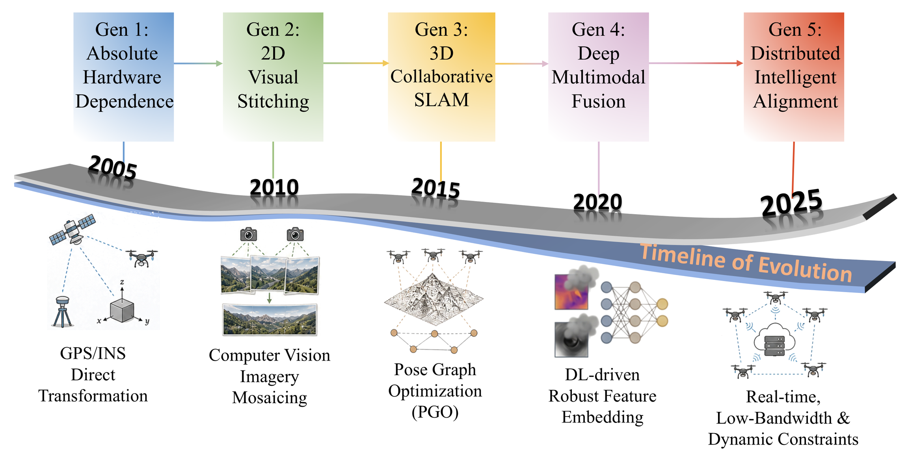
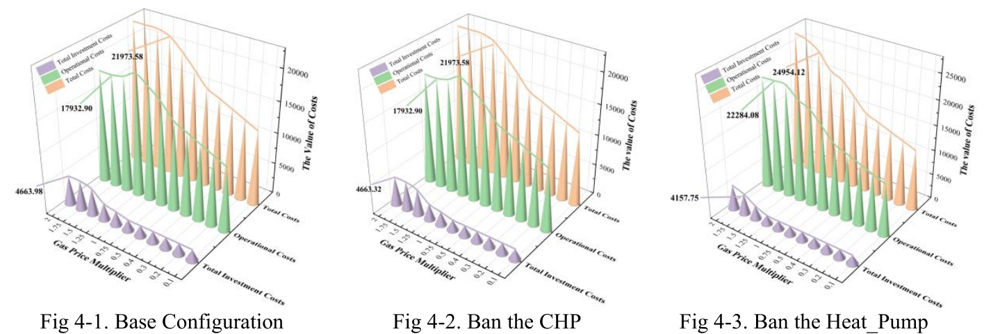

# HKU Research Visualization Portfolio — MSc(Eng) in Electrical and Electronic Engineering

Selected work from my MSc studies at The University of Hong Kong. These two assignments show how I turn technical literature into scientific diagrams and experimental results into figures that support comparisons. Both assignments received positive feedback from their course instructors.

Select any figure to view it at full size.

## Distributed Systems / 分布式系统

**ELEC7083 · Group assignment — literature review** · Course instructor [Prof. Edith C. H. Ngai](https://ece.hku.hk/people/echngai/)

*Spatiotemporal Alignment Technology for Multi-UAV Collaborative Search and Rescue: From Passive Compensation to Active Planning*

Our review connects clock synchronization, asynchronous state recovery and spatial alignment in multi-drone search and rescue. It traces how the literature moves from compensating for timing and position errors to planning trajectories that help prevent them. I contributed to the literature review, manuscript drafting and scientific figures.

**[Read the full literature review online](reports/elec7083-literature-review-online.md)** · [Download PDF](https://github.com/xikun1/HKU-Research-Visualization-Portfolio/releases/download/coursework-pdfs/elec7083-distributed-systems-literature-review.pdf)

### How clock drift affects collaborative perception

The schematic follows a timing mismatch from the clock model to a position error that grows with relative speed. Three scenarios connect that mechanism to practical failure modes in a shared map.

*Literature review, Fig. 1, p. 3.*

### Generational evolution of multi-robot spatial alignment techniques

The timeline traces five generations of spatial alignment techniques. It shows how the field moved from dedicated positioning hardware and image stitching toward collaborative mapping, multimodal fusion and distributed alignment under communication constraints.

*Literature review, Fig. 3, p. 7.*

## Energy Internet / 能源网络

**ELEC7011 · Individual experiment report** · Course instructor [Prof. Yi Wang](https://ece.hku.hk/people/yiwang/)

I ran the course's energy hub optimization model and added parameter sweeps to compare costs across price assumptions, representative-day counts and equipment configurations. The experimental results show when changes in model inputs affect operating costs, equipment investment or both.

**[Read the full experiment report online](reports/elec7011-experiment-report-online.md)** · [Download PDF](https://github.com/xikun1/HKU-Research-Visualization-Portfolio/releases/download/coursework-pdfs/elec7011-energy-internet-experiment-report.pdf)

### Operating and investment cost sensitivity

The paired plots compare operating costs on the left and total investment costs on the right. Each sweep varies one input relative to its baseline while holding the others fixed. The four inputs shown are gas price, electricity price, the load-shedding penalty and investment cost.

*Experiment report, Figs. 3-6 and 3-7, p. 5.*

### Cost trade-offs across equipment configurations

From left to right, the panels show the baseline system, the system without combined heat and power, and the system without the heat pump. They compare how investment, operating and total costs respond to gas prices. The vertical scales differ by panel, so compare costs by reading the plotted values.

*Experiment report, Figs. 4-1 to 4-3, p. 5.*
