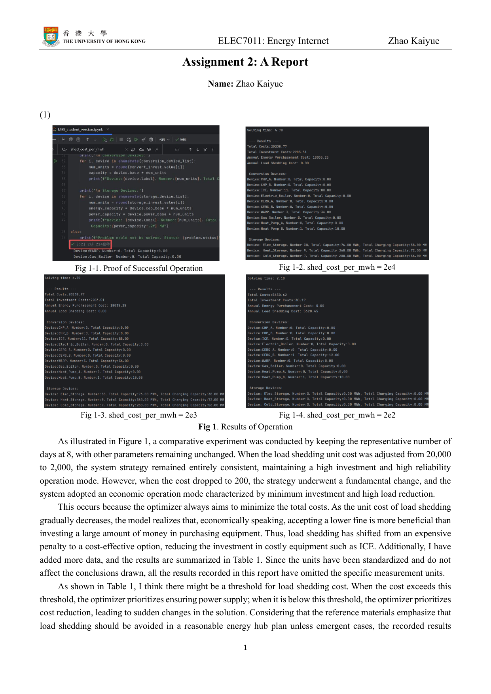
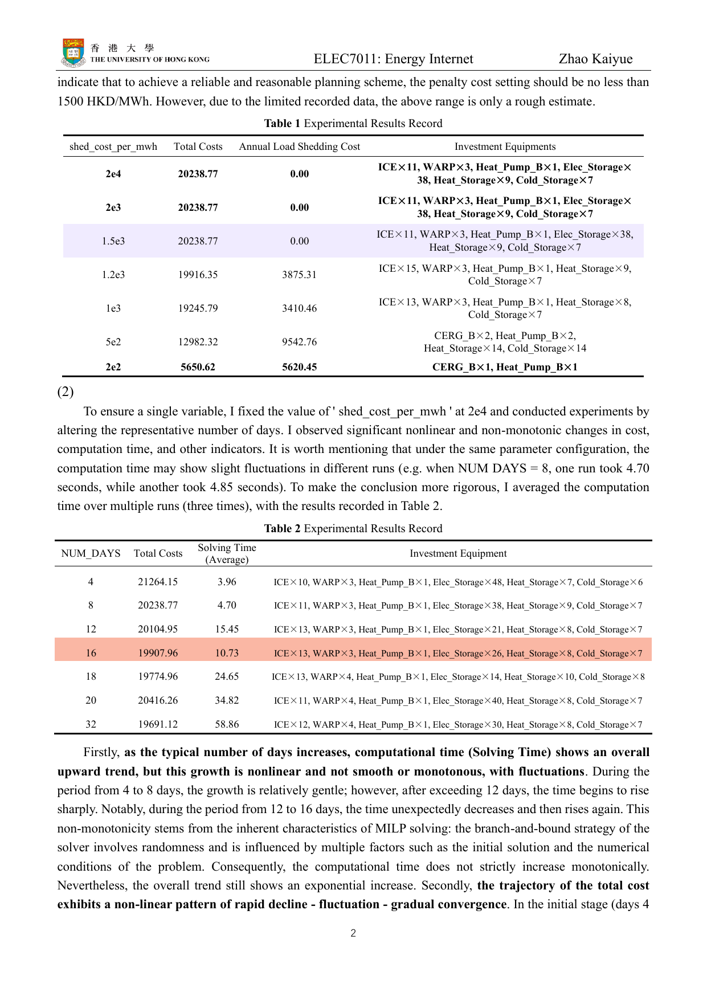
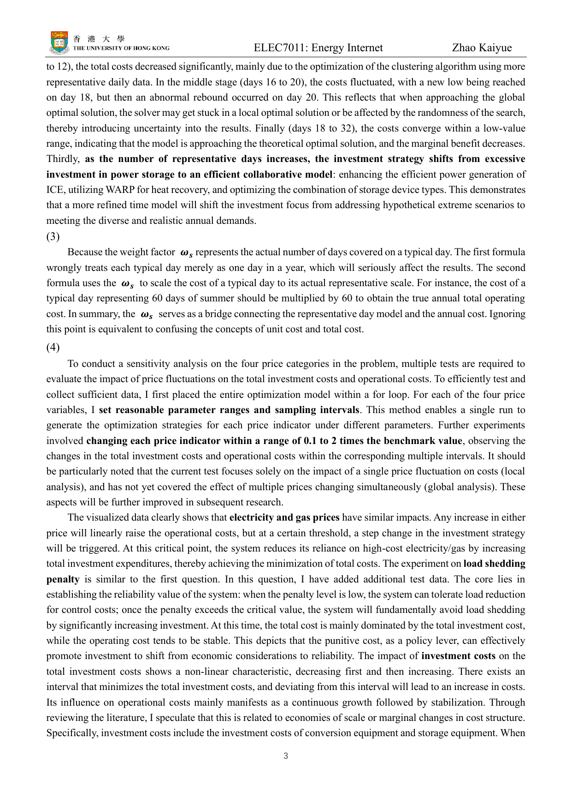
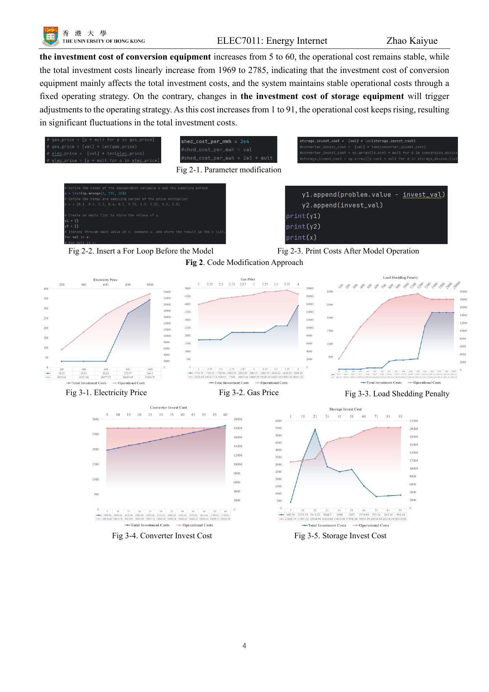
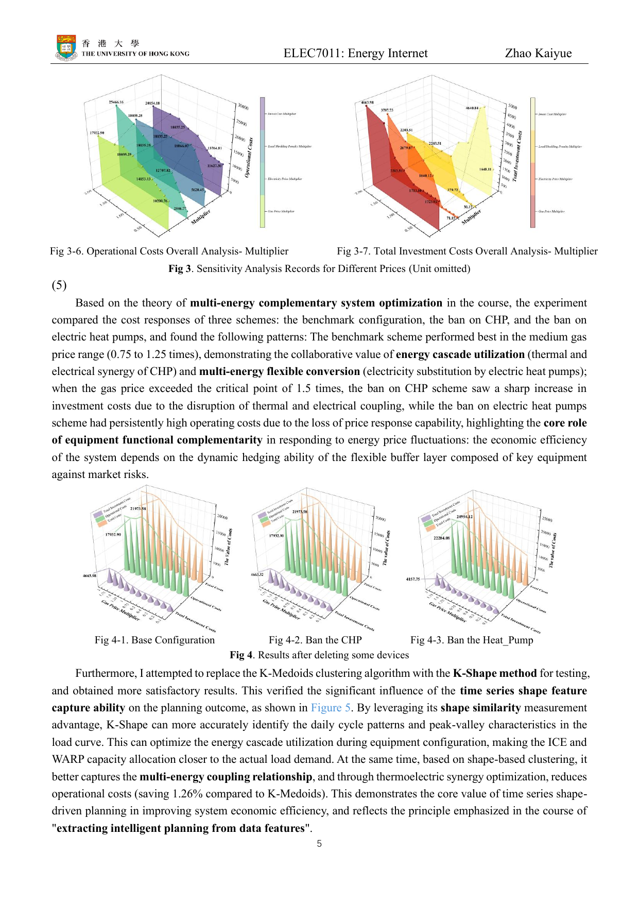
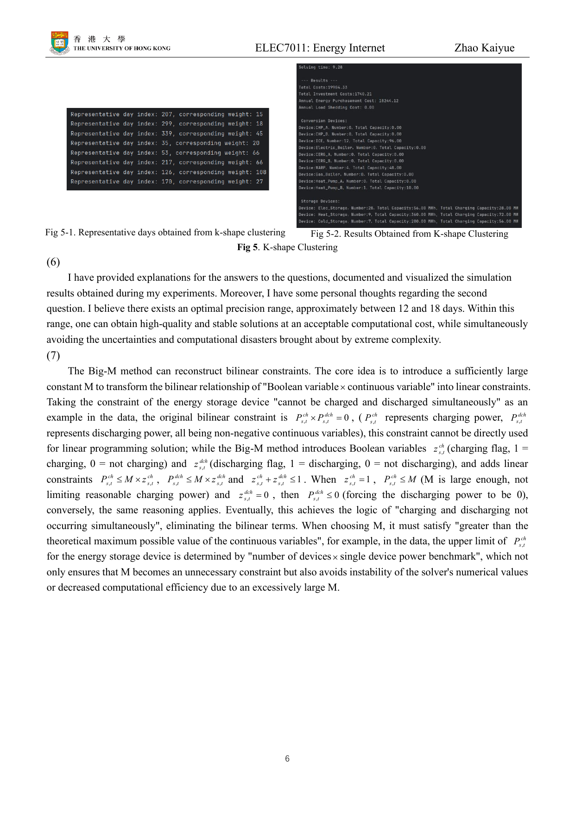

# ELEC7011 Energy Internet — Experiment Report

[Back to portfolio](https://github.com/xikun1/HKU-Research-Visualization-Portfolio) · [Download PDF](https://github.com/xikun1/HKU-Research-Visualization-Portfolio/releases/download/coursework-pdfs/elec7011-energy-internet-experiment-report.pdf)

Select any page to view it at full size.

## Page 1

## Page 2

## Page 3

## Page 4

## Page 5

## Page 6

