# ELEC7083 Distributed Systems — Literature Review

[Back to portfolio](https://github.com/xikun1/HKU-Research-Visualization-Portfolio) · [Download PDF](https://github.com/xikun1/HKU-Research-Visualization-Portfolio/releases/download/coursework-pdfs/elec7083-distributed-systems-literature-review.pdf)

Select any page to view it at full size.

## Page 1

[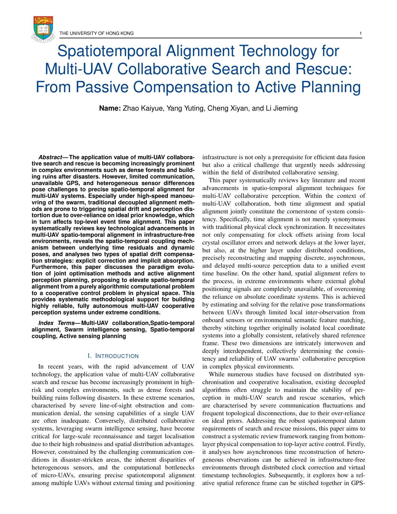](../assets/reading/elec7083/page-01.webp?raw=true)

## Page 2

[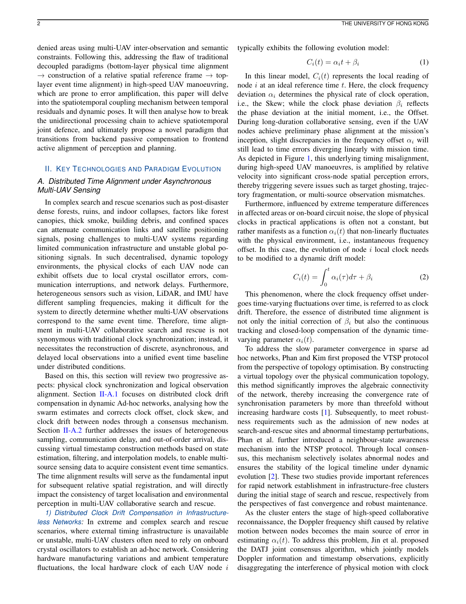](../assets/reading/elec7083/page-02.webp?raw=true)

## Page 3

[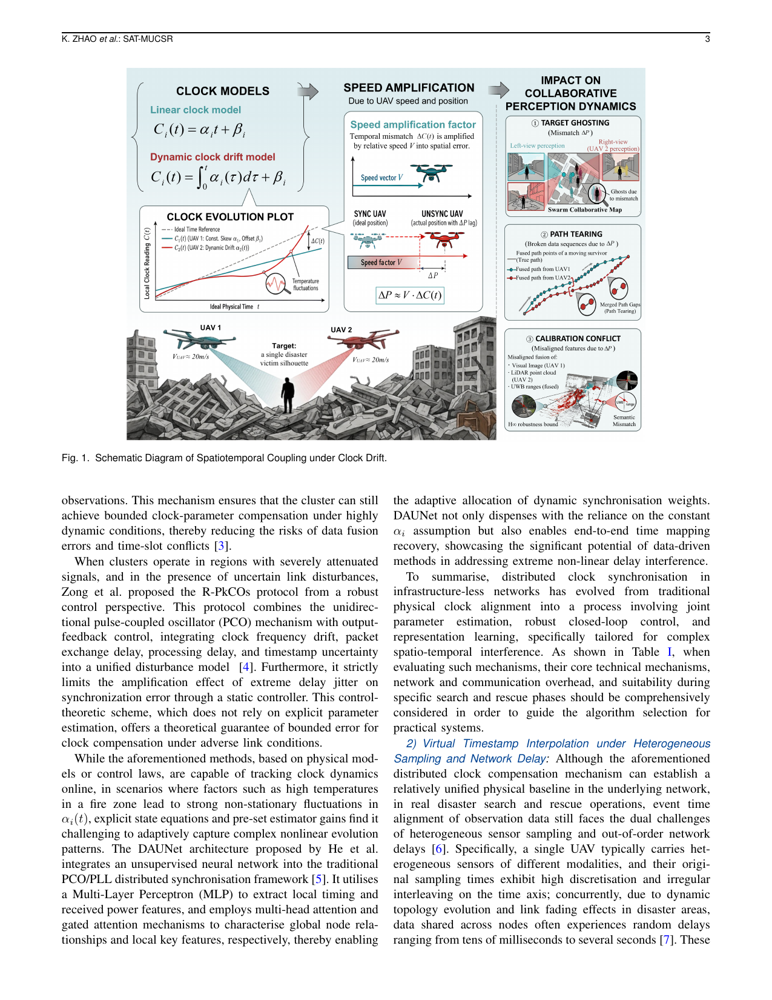](../assets/reading/elec7083/page-03.webp?raw=true)

## Page 4

[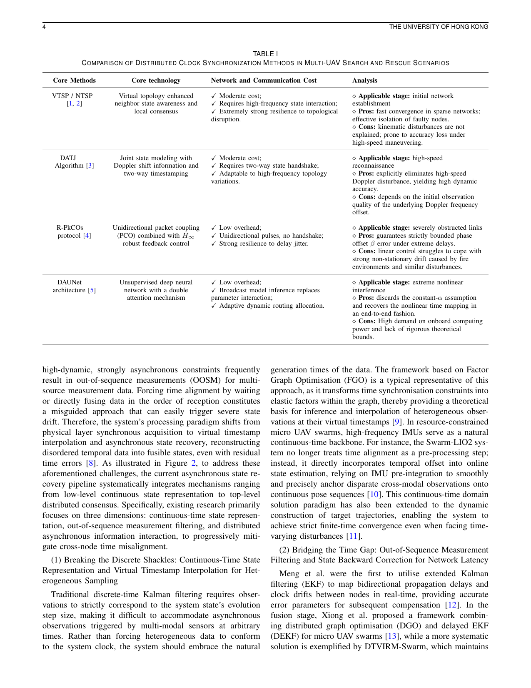](../assets/reading/elec7083/page-04.webp?raw=true)

## Page 5

[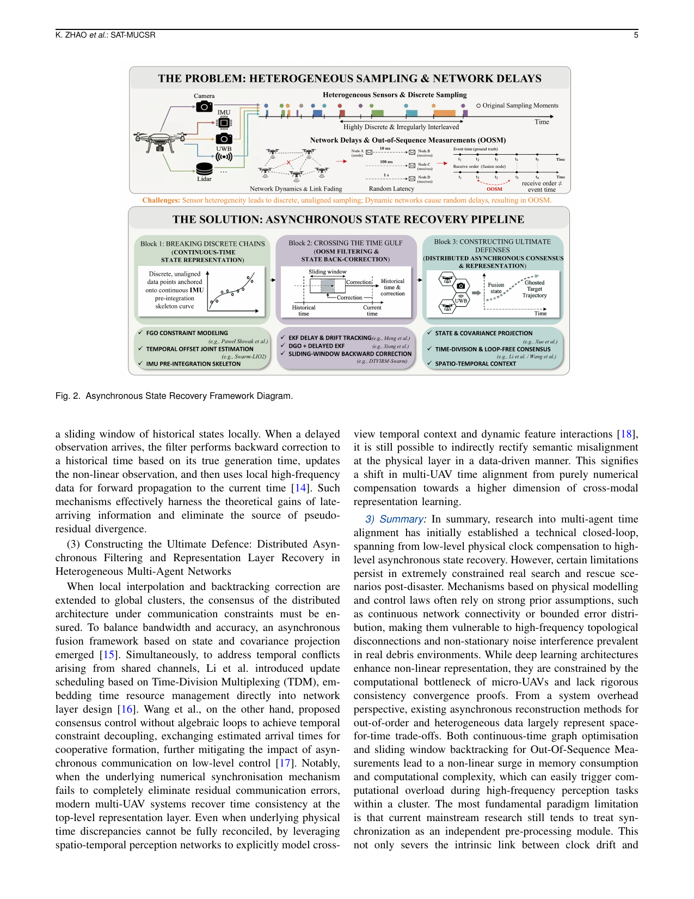](../assets/reading/elec7083/page-05.webp?raw=true)

## Page 6

[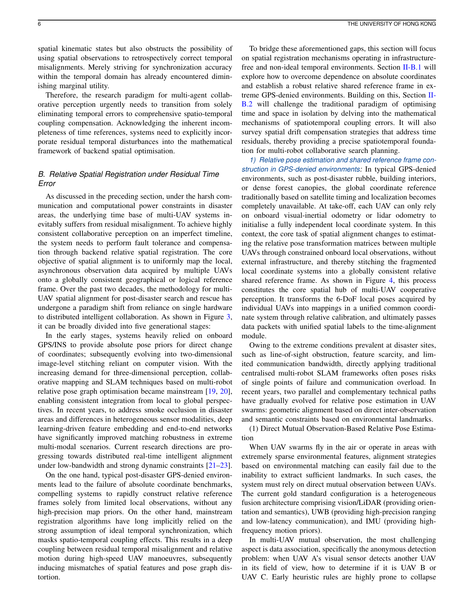](../assets/reading/elec7083/page-06.webp?raw=true)

## Page 7

[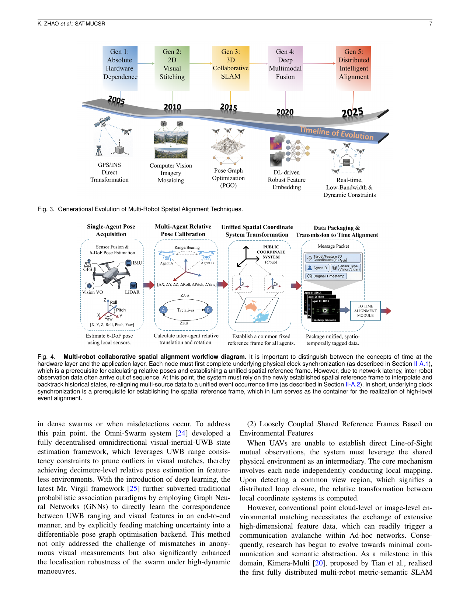](../assets/reading/elec7083/page-07.webp?raw=true)

## Page 8

[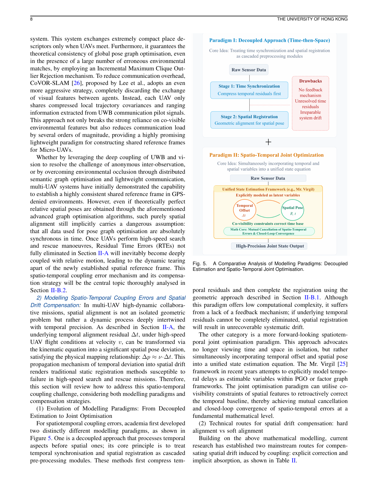](../assets/reading/elec7083/page-08.webp?raw=true)

## Page 9

[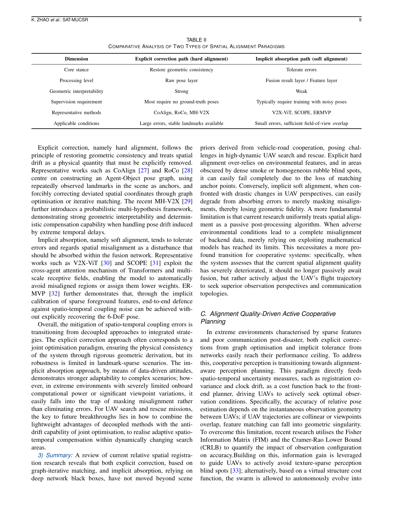](../assets/reading/elec7083/page-09.webp?raw=true)

## Page 10

[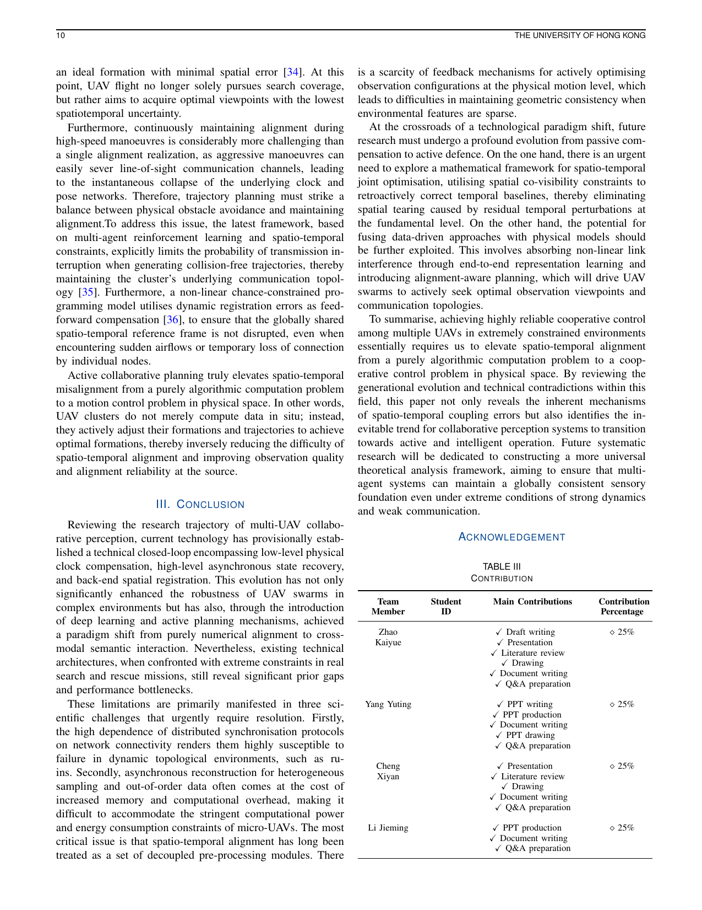](../assets/reading/elec7083/page-10.webp?raw=true)

## Page 11

[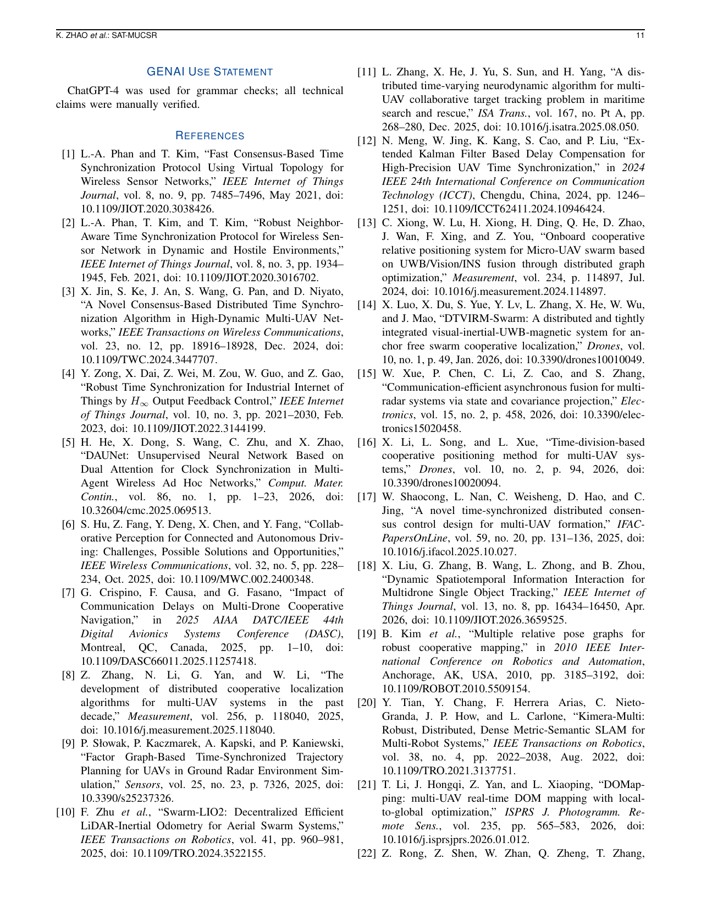](../assets/reading/elec7083/page-11.webp?raw=true)

## Page 12

[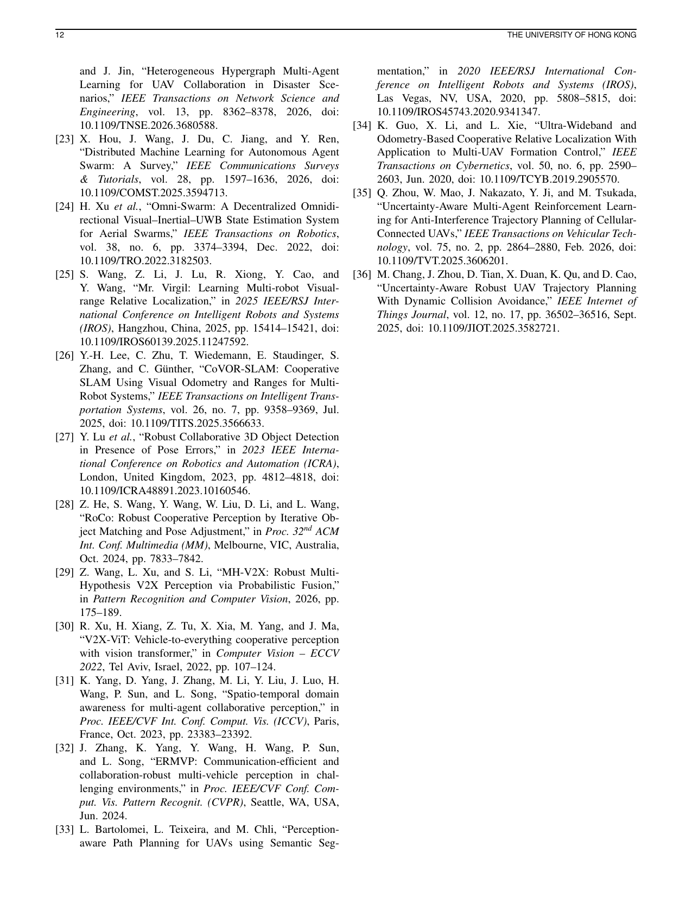](../assets/reading/elec7083/page-12.webp?raw=true)
